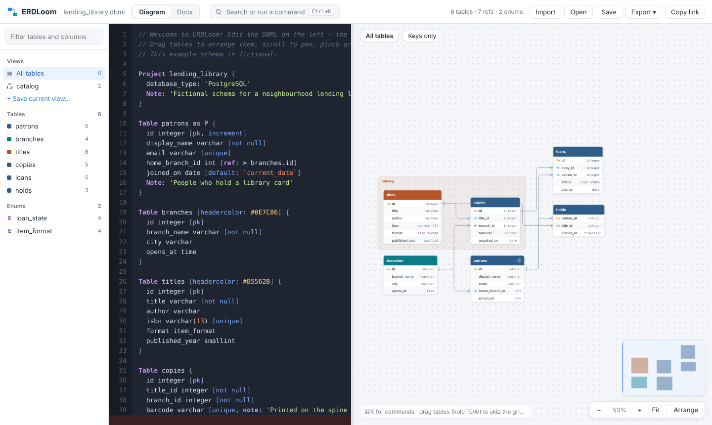
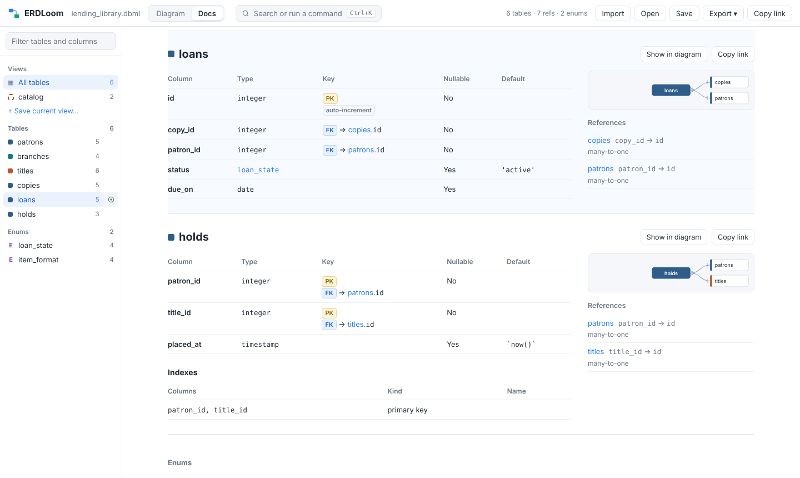
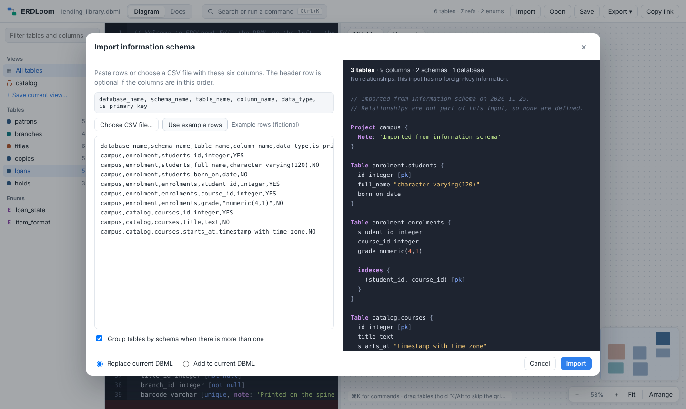

# ERDLoom

**Write [DBML](https://github.com/holistics/dbml), get a live entity-relationship diagram and readable schema docs, all in your browser.**

ERDLoom is a dependency-free editor for DBML (Database Markup Language). You type DBML on the left and the diagram on the right redraws as you type. There's also a Docs tab that turns the same schema into a reference page you can export and share. It runs entirely in the browser, with no server, no build step and no account.



## Quick start

```bash
git clone https://github.com/derekfay84/erdloom.git
cd erdloom
open index.html          # macOS; on Windows use `start index.html`, on Linux `xdg-open index.html`
```

That's all you need. If you'd rather serve it over HTTP, run `npm start` and go to <http://localhost:5173>.

`dist/erdloom.html` is the whole app in a single file, which is handy for sending to someone or keeping offline.

## Features

### Editor and diagram

- **Live diagram.** The diagram updates as you type. If you make a syntax error, the last valid diagram stays on screen, and an error bar shows the line and column; click it to jump there.
- **Relationship lines** attach to the exact column rows, use crow's-foot notation, and route around tables where they can.
- **Arrange freely.** Drag tables and they snap to the grid (hold ⌥/Alt to place them freely). Drag a group by its title to move all of its tables together. Positions are remembered. **Arrange** lays everything out automatically: each `TableGroup` is kept together in its own box, groups that reference each other are placed side by side, and the whole diagram is shaped to fit the space you have (wider when the code editor is hidden).
- **Hover** a table or column to highlight its relationships and see its type, flags, default, note, enum values and references.
- **Export** the diagram as SVG or PNG, save the DBML, or **Copy link** to get a URL with the whole schema compressed into it.
- **Light and dark themes.** The theme button in the top bar (or ⌘/Ctrl+K → *Theme*) switches between matching your system, light and dark. The diagram, Docs tab and dialogs all follow it. Exported SVG, PNG and HTML docs always use the light theme, so they print and share well.

### Built for big schemas

- **Outline rail** with views, tables and enums. Its filter also matches column names.
- **Command palette (⌘/Ctrl+K)** to jump to any table or run any action.
- **Focus mode** shows one table plus its neighbours one, two or three references away.
- **Views:** every `TableGroup` becomes a view, and you can save your own named views. Each group gets its own colour, the same in the diagram, outline and docs; a group's `[color: …]` setting overrides it.
- **Keys only** shows just primary and foreign key columns. It turns on automatically when you zoom out below 50%.
- **Minimap** for getting around.

### Docs tab



Press **D** (or use the Diagram/Docs switch) for a reference page built from the same DBML:

- **Overview:** project note, counts, groups and a table index.
- **One section per table:** columns with types, keys (foreign keys link to their target), nullability, defaults and notes; indexes; what the table references and what references it; and a small diagram of its neighbours.
- **Enums** with their values and the columns that use them.
- **Export → Docs as HTML page** saves a single self-contained file with a contents sidebar, ready to share or print.

### Import from an information schema



**Import** turns rows with exactly these columns into DBML:

```
database_name, schema_name, table_name, column_name, data_type, is_primary_key
```

- Paste text or choose (or drop) a CSV file. Comma, tab, semicolon and pipe separators are detected automatically.
- The header row is optional if the columns are in the order above. With a header, any order works and extra columns are ignored.
- `is_primary_key` accepts `YES`/`NO`, `true`/`false`, `t`/`f`, `1`/`0` and `PRI`. A table with several key columns gets a composite primary key.
- Tables are qualified by schema and grouped by schema.
- You see the generated DBML and any skipped rows before importing. You can then replace your DBML (and restore it later from the command palette) or add the new tables to it.
- These six columns carry no foreign-key information, so the import itself creates no relationships. By default the **Suggest** review opens straight afterwards (see below).

### Suggest relationships and groups

**Suggest** (or ⌘/Ctrl+K → *Suggest relationships and groups*) proposes `Ref`s and `TableGroup`s for the current DBML. It runs entirely in the browser and uses only what the schema says: table and column names, types and keys. It doesn't use AI or need a network connection.

- **Relationships** come from naming patterns: `customer_id` → `customers.id`, `orderId` → `orders.id`, `country_code` → `countries.code` (when `code` is a key), a column with the same name as another table's primary key, role prefixes such as `billing_address_id` → `addresses.id`, and self-references such as `parent_id` or `manager_employee_id`. Plurals and prefixes like `tbl_` or `auth_` are handled.
- Each suggestion is checked against the target: it must point at a primary key or unique column (or a bare `id` when the table declares no key), and the two column types must be compatible. A unique or primary-key column on the referencing side makes it one-to-one.
- Each one gets **High**, **Medium** or **Low** confidence, and the reasons are shown next to it. Columns that already have a reference are skipped.
- **Groups** come from community detection (Louvain) on the graph of relationships, including the suggested ones you have ticked, with a pull towards tables that share a name prefix. They are named after a shared prefix or the best-connected table, and you can rename them. Tables that are already in a `TableGroup` are left out.
- Nothing changes until you tick what you want and press **Add**. The accepted `Ref`s and `TableGroup`s are appended to your DBML, and ⌘/Ctrl+K → *Restore previous DBML* undoes it.

## DBML support

ERDLoom has its own parser (`js/parser.js`), which supports:

| Feature | Examples |
| --- | --- |
| Projects | `Project name { database_type: 'PostgreSQL'  Note: '…' }` |
| Tables | schema-qualified names, `as` aliases, `[headercolor: #hex]`, notes |
| Column settings | `pk`, `unique`, `not null`, `null`, `increment`, `default:`, `note:`, inline `ref:` |
| Indexes | single, composite, composite primary keys, `` `expressions` ``, `name` and `type` |
| References | `Ref: a.x > b.y`, `Ref { … }`, inline refs, composite refs; `<` `>` `-` `<>`; `delete`, `update` and `color` settings |
| Other | `Enum` (with value notes), `TableGroup` (with `color`), `TablePartial` with `~injection`, sticky `Note`, `//` and `/* */` comments, `"quoted names"`, `'''multi-line strings'''` |

## Keyboard shortcuts

| Keys | Action |
| --- | --- |
| ⌘/Ctrl+K | Command palette |
| D | Switch between Diagram and Docs |
| F / 1 | Fit the diagram / zoom to 100% |
| / | Filter the outline |
| Esc | Leave focus or view mode, clear the selection, or clear the docs filter |
| ⌘/Ctrl+B | Show or hide the outline |
| ⌘/Ctrl+\\ | Show or hide the code editor |
| ⌘/Ctrl+S, ⌘/Ctrl+O | Save, open |

Single-key shortcuts only work when you're not typing in a field. Your DBML, table positions, saved views, layout preferences and theme are kept in this browser's local storage.

## Development

There are no runtime dependencies. Node 18 or newer is needed only for the tests and the build.

```bash
npm test         # parser, importer, suggestion, layout and colour tests (node:test)
npm run build    # writes dist/erdloom.html, the single-file build
npm start        # serves the folder at http://localhost:5173 (uses Python 3)
```

| File | What it does |
| --- | --- |
| `index.html`, `css/styles.css` | App shell and styles |
| `js/parser.js` | Tokenizer, parser and model builder. Also works in Node: `require('./js/parser.js').parse(src)` |
| `js/colors.js` | Group colours shared by the diagram, outline and docs |
| `js/layout.js` | Automatic layout: each group laid out on its own (layered by relationship), then groups placed next to the ones they link to, shaped to the screen |
| `js/renderer.js` | SVG diagram: line routing, pan/zoom/drag, minimap, tooltips, SVG/PNG export |
| `js/editor.js` | Code editor with syntax highlighting, line numbers and auto-indent |
| `js/docs.js` | Docs tab and the exported HTML docs page |
| `js/importer.js` | Information-schema rows to DBML. Also works in Node |
| `js/suggest.js` | Rule-based relationship and group suggestions. Also works in Node |
| `js/app.js` | Wires it all together: outline, palette, views, import dialog, persistence |
| `js/sample.js` | The fictional example schema |
| `scripts/build.mjs` | Inlines everything into `dist/erdloom.html` |
| `test/` | Parser, importer, suggestion, layout and colour tests |

`DBML.parse(src)` returns `{ project, tables, refs, enums, groups, notes }`, or throws a `DBMLError` with `line` and `col`.

## License and notices

ERDLoom is released under the [MIT License](LICENSE). All of its code was written for this project. It does not include or depend on any third-party code.

DBML (Database Markup Language) is an open-source language created by Holistics and published under the Apache License 2.0. ERDLoom is an independent implementation of that language. It is not affiliated with, sponsored by, or endorsed by Holistics or any of its products. The DBML name is used only to describe the file format ERDLoom reads.

The example schema in `js/sample.js` and the rows in the screenshots are fictional and were written for this project.
